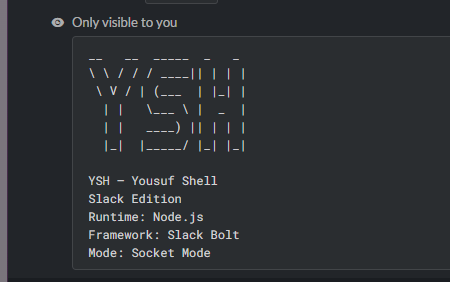
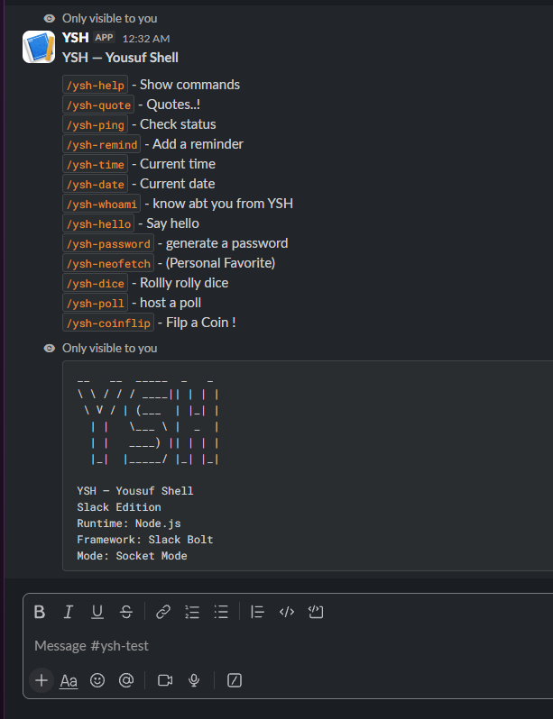
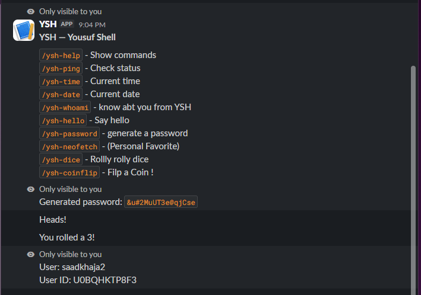

# YSH Slack Bot

YSH — Yousuf Shell, now on Slack.

## Features

- 10 slash commands
- System information
- Easter egg
- Slack-native utilities
- Random password generation
- Dice rolling and coin flipping
- Current time and date
- Personal Slack identity lookup
- 24/7 live deployment

## Examples

### Help

`/ysh-help`

### System Check

`/ysh-ping`

### Time and Date

`/ysh-time`

`/ysh-date`

### Greeting

`/ysh-hello`

### System Information

`/ysh-neofetch`

### More Commands

- `/ysh-coinflip` — Flip a coin
- `/ysh-dice` — Roll a dice
- `/ysh-whoami` — Display your Slack identity
- `/ysh-password` — Generate a random password

## Built With

JavaScript · Node.js · Slack Bolt · Socket Mode · Railway
